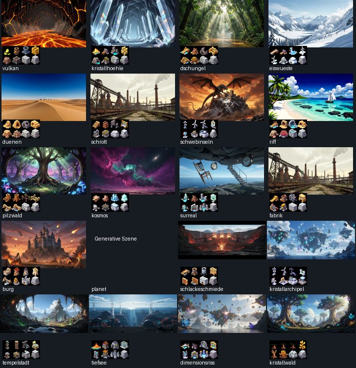

# Design und Bedienung jenseits von Figuren und Waffen

**Prüfstand 8. November 2026 · Ausgangscommit 3230475.** Die größte spielerische Verbesserung in dieser Runde betrifft das Zielen auf dem Telefon. Der erste Kontakt benutzte die zuletzt gespeicherte Zeigerposition. Außerdem konnte das Loslassen eines anderen Fingers oder eine unterbrochene Geste einen Schuss auslösen. Die Korrekturen sind auf diesem Branch implementiert. Für die größte optische Verbesserung empfehle ich als Nächstes drei spielbare Referenzszenen mit lokal scharfem Gelände vor fotografischer Landschaft.

[Messliste mit 633 Bilddateien](asset-inventar.tsv) · [Bildtafel der 20 Biome](biome-und-objekte.jpg) · [Referenzbilder von Menü, Lobby und HUD](../../tests/e2e/visuell.spec.mjs-snapshots) · [Gestaltungsvorlagen des Projekts](../design-vorlagen)

## Bereits im Client korrigiert

| Fläche | Befund im Ausgangsstand | Änderung und Abnahme |
|---|---|---|
| Spielfeld und Feuerknopf | Nur Bewegung aktualisierte die Zeigerkoordinaten. Ein globales Pointer-Up feuerte jede aktive Ladung ab. Pointer-Cancel führte denselben Schusspfad aus. | Die erste Berührung setzt das Ziel in Canvas-Koordinaten. Nur die auslösende Eingabe beendet ihre Ladung. Ein Abbruch verwirft sie. Handprobe mit zwei Zeiger-IDs, Skalierung 2:1 und Tastaturquelle bestanden. Regressionsfall in touch-bedienung.spec.mjs. |
| Hauptmenü | „Spiel einrichten“ war generierter CSS-Inhalt. Die Steuerungsliste erklärt Maus und Tasten, obwohl das Telefon andere Gesten nutzt. | Echte Überschrift in identischer Position. Kurzanleitung für grobe Zeiger erklärt Halten, Ziehen, Loslassen und Gehen direkt bei der Einrichtung. |
| Lobby | „Beitreten“ übernahm lediglich die Lobby-ID. „Leer — du startest“ suggerierte einen sofortigen Start trotz fehlender Menschen. | „Auswählen“ im sichtbaren und zugänglichen Namen. „Alle Plätze frei“ beschreibt die Belegung. Status zählt offene Lobbys im Singular oder Plural. Die Bestätigung nennt den nächsten Schritt. |
| Spielwelt | Ein Geschütz wurde nach der Kiste gezeichnet und konnte ihre Typmarkierung verdecken. Die Absicht im Renderer war die umgekehrte Reihenfolge. | Geschütz zuerst, Kiste darüber. Die Spielregeln und Kollisionsmaske sind davon unabhängig. Sichtprobe mit überlappenden Objekten offen. |
| Matchende | Fokus blieb beim vorherigen Bedienelement. Die Ergebnistabelle nannte eine Prozentspalte „Treffer“. Simulationsticks standen neben der ohnehin separat angegebenen Spielzeit. | Fokus geht zum Siegertext. Spalte heißt „Trefferquote“, Tabellenköpfe sind zugeordnet. Der lokale Kurztext zeigt den reproduzierbaren Seed. Runden und Spielzeit stehen bei den Kennzahlen. |
| Replay-Import | Bei syntaktisch gültigem JSON mit ungültigem Replay-Inhalt wurde die Fehlermeldung durch „Geladen“ überschrieben. | Erfolg erscheint nur, wenn der Player das Dokument annimmt. E2E-Fall mit fremder JSON-Datei ergänzt. |

## Wie das Spiel tatsächlich aussieht

Die drei eingecheckten Referenzbilder zeigen einen Desktop mit 1280 × 720. Sie stammen aus dem Repository. Sie sind Belege für das Ausgangslayout und keine Screenshots dieses Patches. Im Startbild ist die Ananasgranate gut erkennbar, und die große grüne Startfläche gewinnt gegen die kleineren Bedienelemente. Im Lobbybild sitzen beide Karten im schmalen linken Bereich. Der breite rechte Bereich bleibt bei dieser Scrollposition fast vollständig leer. Im HUD sind Feuerknopf und aktiver Waffenslot gut zu finden. Die kleinen P-Markierungen, das Protokoll über der unteren Leiste und die Statuskarten oben konkurrieren auf kleinem Display um Lesefläche.

Der bestehende Look funktioniert am besten, wenn er drei Aufgaben trennt: Hintergrund zeigt den Ort, die obere Geländekante zeigt den begehbaren Weg, und Figuren, Kisten und Gefahrensymbole zeigen die nächste Entscheidung. Die grünen Akzente des Menüs und der gelbe Feuerknopf dürfen ihre feste Bedeutung behalten, unabhängig von der Fraktion. Fraktionsschriften gehören auf Namen und Banner. Für Windwerte, Trefferwerte und längere Hilfetexte ist die gemeinsame UI-Schrift besser lesbar.

## Bilder, Speicher und 4K

| Gruppe | Bestand und Befund | Konsequenz |
|---|---|---|
| Klassische Kulissen einschließlich Stimmungen | 224 WebP, 18.994.910 Byte insgesamt. Darunter 80 Bilder mit 1280 × 720. | Die Bildauswahl funktioniert bereits über die URL-Kataloge. Höhere Auflösung als optionale Variante unter gleichem Motivschlüssel anbinden. |
| Neue Kulissen | 48 WebP, 6.516.864 Byte insgesamt. 24 quer mit 1536 × 672, 24 hoch mit 768 × 1344. | Beim breiten Master entscheidende Formen ins sichtbare Quellrechteck legen. Historische Hochformatkarten im Replay berücksichtigen. |
| Farbwiedergabe | Keine der 272 Dateien erreicht UHD. Kein eingebettetes ICC-Profil in diesen Dateien; der Hauptcanvas fordert einen gewöhnlichen 2D-Kontext an. | Eine belastbare HDR-Ausgabekette ist in diesem Pfad nicht belegt. Erst ein hochwertiges SDR-Master testen, HDR erst nach Prüfung bis zur Anzeige ausweisen. |
| Terrain | 36 Materialvorlagen, 15 bestehende und 85 neue 512er-Stofftexturen, zwei weitere Terrainvorlagen. Die 512er-Dateien haben 99 unterschiedliche Basisnamen. | Den großen Quellbestand getrennt von den ausgelieferten Texturen bewerten. Bei vollständiger Registrierung belegen 99 RGBA-Pixelfelder rechnerisch 99 MiB zuzüglich weiterer Canvas- und Bildspeicher. Kein gemessener Peak. |
| Biomobjekte | 19 Bögen mit 1024 × 512. Nummer 14 nutzt einen eigenen generativen Planetenpfad. | Die isometrischen Bögen geben Form und Materialien vor. Seitenansicht neu zeichnen, Anker setzen und begehbare Flächen explizit festlegen. |
| Effekte und Tiere | Zwölf Effektbögen, je 14 PNGs für Günther und Cookie. Gemischte Rastergrößen bei den Effekten. | Das jeweilige Frame-Raster in effektSheets.js verwenden. Tieranimation, Warnsymbol und Text gemeinsam in Spielgröße prüfen. |

**Umsetzungsvorschlag für 4K.** Vulkan, Eiswüste und Schrottplatz zuerst. Pro Ort dasselbe Kamerabild mit 1280er-, 1920er- und 3840er-Quelle vergleichen. Die größte Stufe nur für das gewählte Motiv laden, die kleinere bis zum erfolgreichen Dekodieren zeigen und bei Fehler beibehalten. Ein einzelner dekodierter UHD-RGBA-Puffer braucht rund 31,6 MiB. Ein zusätzlicher Canvas-Cache kann weiteren Speicher kosten. Die aktuelle Grafikstufe begrenzt unter anderem Geländefläche und Partikel, sie wählt noch keine UHD-Kulisse. Die Bildabnahme umfasst Schwenk bis an beide Kartenränder, Zoom, obere und untere Spielfeldkante, Schnee und Gegenlicht, erste Bedienbarkeit, Speicher vor/nach drei Kartenwechseln und Bildzeiten auf iPhone und älterem Desktop. Zuerst das Vergleichsbild im tatsächlichen Spielfeld beurteilen: Ein UHD-Master allein garantiert keine sichtbare UHD-Ausgabe.

## Art Direction je Biom

Je Zeile zeigt die Tafel das erste hinterlegte automatische Kulissenmotiv und verkleinert den nummerierten Objektbogen. Beim Planeten verweist sie auf die generative Szene. Die Vorschläge betreffen die Optik. Für neue zerstörbare oder gefährliche Objekte braucht es zusätzlich ein definiertes Motorverhalten.

| Biom | Konkrete Gestaltung für den spielbaren Vordergrund |
|---|---|
| Vulkan | Die Bodenkante als dunkle Basaltkruste lesen lassen. Glut nur in Rissen und an tatsächlicher Lava, damit jede rote Fläche eine verständliche Bedeutung hat. |
| Kristallhöhle | Grobe Felskontur trägt die Figur. Wenige große, seitlich beleuchtete Prismen setzen die Identität. Kleine weiße Spitzlichter am Fadenkreuz vermeiden. |
| Dschungel | Helle Lichtung im Foto lassen, Wurzeln am Vordergrund als Plattformquerschnitt führen. Rankendeko hinter Figuren und Flugbahn halten. |
| Eiswüste | Schneeoberkante, blauer Eiskern und dunkler Tiefenfels ergeben drei lesbare Schichten. Weiße Projektilspuren auch am hellen Berghang prüfen. |
| Dünen | Der ruhige Horizont verträgt einen groben angeschnittenen Sandsteinsockel. Dünendeko darf optisch keine zweite Bodenkante bilden. |
| Schrottplatz | Schrott, Reifen und geknickte Bleche als niedrige Haufen zeichnen. Von der Fabrik durch unregelmäßige Silhouette und warmen Rost trennen. |
| Schwebinseln | Jede begehbare Insel braucht eine klare Oberseite und eine frei auslaufende Unterseite. Der Drache auf dem ersten Hintergrundmotiv kann mit einem spielbaren Wesen verwechselt werden. |
| Riff | Wassergrenze durch eine durchgehende erkennbare Linie tragen. Türkis für die Ferne, dunkle Koralle für tragende Plattformen. |
| Pilzwald | Pilzkappen und Myzelfasern geben eine eigene, organische Silhouette. Gefährliche Säure braucht ein wiederkehrendes Zeichen zusätzlich zur grünen Farbe. |
| Kosmos | Dunkler Regolith mit kantigen Metalleinschlüssen vor weichem Nebel. Sternpunkte gegenüber kleinen Projektilen abdunkeln. |
| Surreal | Perspektive im Hintergrund brechen, auf der Spieloberfläche eine eindeutige Kontaktkante behalten. Eine schwebende Treppe in der Ferne darf kein gangbarer Weg zu sein scheinen. |
| Fabrik | Schrottplatz und Fabrik teilen im ersten Motiv dieselbe Industrieruine. Senkrechte Träger, Geschossdecken und durchgeschnittene Räume geben der Fabrik ein eigenes Profil. |
| Burg | Mauerfugen unter der Deckkante fortführen. Krenelierung und Brückenauflager verraten das Material auch nach einem Krater. |
| Planet | Der eigene Szenenrenderer ist gestalterisch wertvoll. Für alle sechs Teilwelten Boden und Abgrund im selben Kamerawinkel vergleichen, bevor dafür Bildvarianten bestellt werden. |
| Schlackeschmiede | Einen großen Industrieofen mit seitlicher Auslassöffnung als Landmarke wählen. Parallele Schienen und Keramikplatten unterscheiden diesen Ort vom Naturvulkan. |
| Kristallines Schwebearchipel | Blauweiße Gesteinskörper, Klareis und dunkle Magnetadern. Die Inseln aus Nr. 7 durch Material und Form unterscheidbar machen. |
| Bio-Alien-Tempelstadt | Regelmäßige Steinblöcke mit unregelmäßigem Harz überwachsen lassen. Bei zerstörten Flächen muss darunter der bearbeitete Stein erkennbar sein. |
| Abyssale Tiefsee | Helle Wasseroberfläche nach hinten, korrodierte Druckkörper und dunkle Felskante nach vorn. Gefahr am unteren Rand auch bei blauem Licht lesbar halten. |
| Dimensionsriss | Spektrale Versätze auf Hintergrundteile begrenzen. Landekante und Flugbahn müssen selbst vor schwebenden Splittern stabil lesbar bleiben. |
| Versteinerter Kristallwald | Stämme im Querschnitt mit Jahresringen und mineralischen Brüchen zeigen. Silhouette holzig halten, damit der Ort neben Kristallhöhle und Pilzwald eigenständig wirkt. |

## Offene Arbeiten in sinnvoller Reihenfolge

| Prio | Bereich und Grundlage | Abnahme |
|---|---|---|
| 1 | Touch und Bedienhilfen. Die bestehende Querformatvorgabe, Systemkontrast und Bewegungsreduktion sind implementiert. Echter Bildschirmleser und Systemgesten sind mit DOM-Tests allein nicht abgedeckt. | Auf dem iPhone ersten Schuss, zwei gleichzeitige Finger, Unterbrechung, System-Drehung und Rückkehr prüfen. Mit Tastatur und VoiceOver vom Menü bis zum Ergebnis und wieder zurück. |
| 1 | Lobby. Die schmale Kartenliste verschenkt bei Desktopbreite Platz. Server-URL und Lobby-ID erscheinen auch beim lokalen Schnellstart. | Eigenen Online-Bereich mit breiter Ergebnisliste gestalten. Lokalstart in einer Aktion, Online-Auswahl in zwei verständlichen Schritten. Leer, voll, getrennt und Serverfehler einzeln prüfen. |
| 1 | HUD und Meldungen. Rundenzeit, Rückzugszeit und Zugpause benötigen auf Telefonen dieselbe Blickposition. Protokoll, Toast und Tier-HUD können gleichzeitig aktiv sein. | Beim kleinsten unterstützten Querformat maximal gefüllte Teams, Toasts, Ereignis und Waffenwahl gemeinsam darstellen. Prüfen, dass aktiver Spieler, Zeit, Ziel und Feuerknopf erkennbar bleiben. |
| 1 | Kisten, Türme, Minen und Abwürfe. Der Kistenrenderer verwendet bereits Formen für den Typ und Farbe für Seltenheit. | In der kleinsten Zoomstufe eine Waffenkiste, Falle und leere Kiste in Graustufen unterscheiden. Dieselbe Szene bei Schnee, Lava und dichtem Hintergrund abnehmen. |
| 1 | Grafikspeicher und Ladezeit. Der Aufruf in main.js lädt das gesamte Stoffpaket im Leerlauf oder beim Matchstart. | Vor UHD-Ausbau tatsächlichen Spitzenverbrauch messen. Falls nötig nur die Stoffe der aktiven Karte laden; bei Kartenwechseln veraltete Rückrufe und Cachewachstum prüfen. |
| 2 | 4K-Pilot und Fotomotive. Der aktuelle Kulissenpfad hat bereits Zuschnitt, Parallaxe, Sättigungsdeckel und Abdunkelung. | Drei Master mit festem Seed gegen das Original vergleichen. Terrainmaske, Weltkoordinaten und Treffer dürfen sich bei Bildwechsel nicht verschieben. |
| 2 | Objektkunst. Die 19 Bögen sind Referenzmaterial in isometrischer Perspektive. | Zuerst Kessel, Schrottfass und Kristallsteg in Seitenansicht. Je Objekt Bild, Bodenkontakt, Verdeckung und Verhalten nach einem Krater schriftlich festlegen. |
| 2 | Effekte und Wetter. Einschlag, Rauch, Wasser, Wetterlicht und Kamerabeben haben getrennte Zeichenpfade. | Dieselbe Explosion bei Nacht und Schnee aufnehmen. In reduzierter Bewegung bleiben Trefferort und Konsequenz mit ruhigem Zeichen sichtbar. |
| 2 | Sieg und Revanche. Online und Replay führen zur neuen Partie über das Menü; lokal beginnt die Revanche unmittelbar. Derzeit steht überall „Revanche“. | Beschriftung je Modus testen. Meistgenutzte Waffe anhand ihrer Matchfassung benennen. Alte Aufzeichnungen und unbekannte IDs abdecken. |
| 2 | Replays, Profil und Konto. Es gibt Dateiimport, Datensicherung und Rangliste, erreichbar über separate Klappbereiche. | Eine misslungene Dateioperation am Eingabefeld erklären. Vor Ersetzen eines Profils Quelle und Auswirkung verständlich machen. Fehler darf erreichbare Daten und Navigation nicht verdecken. |
| 3 | Musik und Effekte. Stumm und Lautstärke sind getrennt vorhanden; Browser können Wiedergabe bis zur ersten Geste verhindern. | Vom stummen Start über erste Interaktion, Stummschaltung und Wiederaufnahme bis Spielende testen. Wichtige Warnung sowohl hörbar als auch sichtbar prüfen. |
| 3 | Markenzeichen, Schrift und Nebenflächen. Das Menülogo ist prägnant, die hochverdichtete Displayschrift wird auch für kleine Werte genutzt. | Zahlen und Labels in Spielgröße auf iPhone und Desktop vergleichen. Fraktionsschriften für Identität, die gemeinsame Leseschrift für Bedienung und Hilfetext verwenden. |
| 3 | Visuelle Regression. Die strukturellen Vergleichsbilder zeigen Menü, Lobby und HUD in 1280 × 720. Weitere funktionale Mobiltests existieren. | Eigene feste Bildstände für Telefon quer, Ergebnis und belastetes HUD ergänzen. Neue Baselines erst nach Sichtprüfung übernehmen. |

## Prüfung und Grenzen

Die Bildliste ist eine Dateimessung in 13 ausgewählten Asset-Verzeichnissen. Enthalten sind Pixelmaße, Bytes, Pfad und Vorhandensein eines ICC-Profils. Sie umfasst Quellmaterial und Laufzeitdateien. Die Bildtafel bewertet jeweils ein repräsentatives Motiv pro Biom, nicht jede Wetter- und Zoomkombination. Farben und Bewegungen auf realen HDR-Displays wurden nicht gemessen.

Zur Wiederholung: `npm test`, `npm run check:docs`, `npm run build` und `npx playwright test tests/e2e/{lobby-browser,replay,sieg-dialog,touch-bedienung,visuell}.spec.mjs`. Lokal konnte der Browser-Vergleich nicht starten: Der passende Playwright-Browser fehlte und das System-Chromium scheiterte am Start seines Prozess-Sockets. Alte Vergleichsbilder wurden beibehalten. Vor einer visuellen Freigabe sind ein Browserlauf und die Prüfung auf echter Hardware offen.
