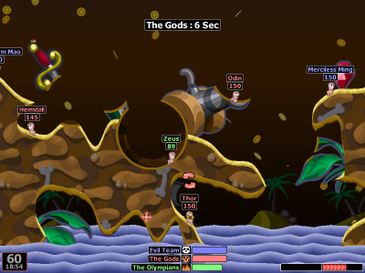
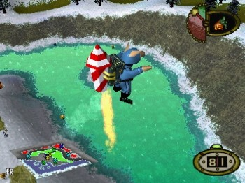
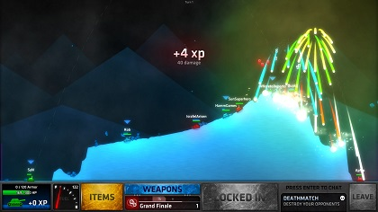
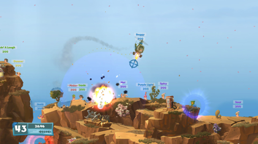

# Vergleich: ProjectArmageddon vs. Alternativspiele

Stand: 2026-10-19 · Auftrag: „für alle Bereiche ausgiebige Tests fahren und
Screenshots vom Playwright machen, um diese mit Alternativspielen
(Worms/Frontschweine/moderne Ansätze) zu vergleichen.“

Alle Zahlen in diesem Dokument sind gemessen (Belegbefehle in Abschnitt 2).
Screenshots liegen unter `eigene/` (ProjectArmageddon) und `referenzen/`
(Vergleichsspiele).

---

## 1. Methode

1. **Unit-/Integrationstests** komplett gefahren (`npm test`).
2. **Alle Prüfwerkzeuge** gefahren (`npm run checks`, 21 Gates).
3. **Browser-E2E** komplett gefahren (`npm run test:e2e`, Playwright).
4. **Screenshot-Sweep** als eigene E2E-Spezifikation
   (`tests/e2e/vergleich-screenshots.spec.mjs`): 27 Bilder, die jeden
   sichtbaren Bereich abdecken — Menü, Kader, Hilfe, Klassen, Sidegrades,
   Erfolge, Profil, Replay, Lobbys, alle acht Geländeformen, Bildkulisse,
   Hochformat, große Teams, Zielvorschau, Schuss/Krater, Wasser, Mahlstrom,
   Günther-Rad, Replay-Wiedergabe, Spielende.
5. **Referenzbilder** der Vergleichsspiele von Wikipedia/Steam geladen und
   visuell ausgewertet.

---

## 2. Testergebnisse (gemessen)

| Lauf | Befehl | Ergebnis |
|---|---|---|
| Unit-/Integrationstests | `npm test` | **1309/1309 bestanden, 0 rot, 0 übersprungen** (51,1 s) |
| Prüfwerkzeuge | `npm run checks` | **21 Gates, 0 Verstöße** (51,5 s) — nach Korrektur der Doku-Zahlen (check:docs hatte 136 Testdateien gemeldet, gemessen 137) |
| Screenshot-Sweep | `npx playwright test tests/e2e/vergleich-screenshots.spec.mjs` | **27/27 bestanden** (2,6 min) |
| Browser-E2E (Gesamtbatterie) | `npm run test:e2e` | **232 Tests: 228 bestanden, 2 rot, 2 übersprungen** (27,4 min). Die beiden roten Läufe wurden einzeln nachgefahren und sind grün: `online-sprung-abwurf.spec.mjs` 3/3 (Timeout-Flake), `profiling.spec.mjs` 60-Hz-Budget 1/1 (0,90 ms Aufschlag; lastempfindliche Bildzeitmessung, Software-Rasterung). |

Der Sweep sichert je Bereich eine Mindestzusage ab: Seite lädt ohne
Seitenfehler, Menü öffnet/schließt sich, HUD steht. Ein Bereich, der sich
nicht mehr zeichnen ließe, würde den Lauf brechen.

---

## 3. Screenshot-Katalog (eigene Bilder)

| # | Datei | Bereich |
|---|---|---|
| 01 | `eigene/01-menue-hauptmenue.png` | Hauptmenü: Teams, Einheiten, Kulisse, Seed, Bodenberechnung, Server/Lobby, Tastenliste |
| 02 | `eigene/02-menue-kader.png` | Kader: 9 Fraktionen, 81 Charaktere mit Bild, Kampfweise, Superwaffe, Counterplay |
| 03 | `eigene/03-menue-hilfe.png` | Hilfe: Klassen, Loot, Gelände |
| 04 | `eigene/04-menue-klassen.png` | Klassen je Platz: freie Kombination Klasse × Archetyp |
| 05 | `eigene/05-menue-sidegrades.png` | Sidegrades: Trade-offs je Klasse |
| 06 | `eigene/06-menue-erfolge.png` | Erfolgsübersicht mit Fortschritt |
| 07 | `eigene/07-menue-profil.png` | Profil: Kennzahlen, Sicherung, Zurücksetzen |
| 08 | `eigene/08-menue-replay.png` | Replay-Auswahl (nur Eingaben, kein Verlauf) |
| 09 | `eigene/09-menue-lobbys.png` | Offene Lobbys anzeigen |
| 10 | `eigene/10-spiel-huegel.png` | Spielansicht Hügel: HUD (Runde, Wind, Zugzeit, Status, Netz), Spielerliste, Waffenliste, Log |
| 11 | `eigene/11-spiel-gebirge.png` | Geländeform Gebirge |
| 12 | `eigene/12-spiel-inseln.png` | Geländeform Inseln |
| 13 | `eigene/13-spiel-hoehlen.png` | Geländeform Höhlen |
| 14 | `eigene/14-spiel-ebene.png` | Geländeform offene Ebene |
| 15 | `eigene/15-spiel-tuerme.png` | Geländeform Türme (Spires) |
| 16 | `eigene/16-spiel-flut.png` | Geländeform Flut |
| 17 | `eigene/17-spiel-warren.png` | Geländeform Warren |
| 18 | `eigene/18-spiel-bildkulisse.png` | Gewählte Bildkulisse (Cosmos/Schwarzes Loch) statt generativer Szene |
| 19 | `eigene/19-spiel-hochformat.png` | Hochformat (Portrait-Karte) |
| 20 | `eigene/20-spiel-grosse-teams.png` | 8 Teams × 5 Figuren (40 Figuren) |
| 21 | `eigene/21-spiel-zielen.png` | Zielen mit Bahnvorschau (Winkel, Kraft, Flugbahn) |
| 22 | `eigene/22-spiel-schuss-krater.png` | Schuss mit Krater (Terrain-Destruktion) |
| 23 | `eigene/23-spiel-wasser.png` | Wasser: Flutkarte mit angehobenem Pegel |
| 24 | `eigene/24-spiel-mahlstrom.png` | Mahlstrom ab Runde 8 (schrumpfende Zone) |
| 25 | `eigene/25-spiel-guenter-rad.png` | Günther-Begegnung (Glücksrad) |
| 26 | `eigene/26-spiel-replay.png` | Replay-Wiedergabe (deterministisch, sprungfähig) |
| 27 | `eigene/27-spiel-ende.png` | Spielende: Sieger, Kennzahlen, Beitragstabelle, Revanche |

---

## 4. Die Vergleichsspiele

### 4.1 Worms (klassisch) — Worms World Party / Armageddon, Team17

- 2D-Artillerie mit vollständig zerstörbarem Terrain, Wasserlinie, Seil/Werkzeuge.
- Rundenbasiert, Hot-Seat und Online, bis 6 Teams, Zugtimer pro Team.
- ~60 Waffen/Nutzen, großer Wiedererkennungswert durch Wurm-Charaktere.
- **Relevanz:** Das direkte Vorbild. ProjectArmageddon teilt mit Worms das
  Kernprinzip (Winkel/Kraft, Wind, zerstörbares Gelände) und setzt es
  deterministisch um.

### 4.2 Frontschweine (Hogs of War, Infogrames, 2000)

- 3D-rundenbasiertes Artillerie-/Taktikspiel mit Schweinen im Comic-Look (PS1).
- **Klassen und Beförderungen:** Medic, Engineer, Heavy, Spy … — Einheiten
  steigen im Rang auf und verbessern sich. Das ist der nächste Verwandte des
  Klassen-/Loadout-Systems von ProjectArmageddon.
- Jetpacks als Bewegungswerkzeug, Humor/Sprachausgabe als Markenzeichen.
- **Relevanz:** Zeigt den Klassen-/Progression-Gedanken, den PA auf 2D
  überträgt (Klassen je Platz, Sidegrades).

### 4.3 Moderne Ansätze — ShellShock Live (kChamp Games, 2020)

- 2D-Multiplayer-Artillerie mit Panzern, **400+ aufwertbaren Waffen**,
  XP-Rängen (100) und Panzer-Anpassung.
- Voller Onlineschwerpunkt (8 Spieler, Teams und FFA), Level-Editor,
  Naturkatastrophen, kein Pay-to-win (Inhalte erspielbar).
- **Relevanz:** Der moderne Benchmark für Progressionstiefe und
  Langzeitmotivation. PA hat 150 Waffen + Erfolge + Profil, aber keine
  Waffen-Upgrades/Ränge.

### 4.4 Moderne Ansätze — Worms W.M.D (Team17, 2016)

- Modernisiertes Worms: 2.5D-Optik, **Fahrzeuge** (Panzer, Mech, Helikopter),
  **betretbare Gebäude/Bunker**, Crafting, klassisches Arsenal.
- **Relevanz:** Zeigt, wie das klassische Prinzip modernisiert wird, ohne den
  Kern zu verlieren. Fahrzeuge/Gebäude fehlen PA bisher; PA setzt mit
  Auto-Turret/Statue auf aufstellbare Geschütze.

---

## 5. Bereichsvergleich

| Bereich | Worms klassisch | Frontschweine | ShellShock Live | Worms W.M.D | **ProjectArmageddon** |
|---|---|---|---|---|---|
| Perspektive | 2D | 3D (Low-Poly) | 2D | 2.5D | **2D (Canvas, Vektor + Kulissen)** |
| Terrain | zerstörbar, 1D-Höhenlinie | 3D-Höhen | zerstörbar, leuchtend | zerstörbar, 2.5D | **8 Geländeformen, 2560×1440, Material (Eis/Gummi), Wasserfeld, Mahlstrom-Schrumpfung** |
| Waffen | ~60 | wenige, klassenabhängig | 400+, aufwertbar | großes Arsenal + Crafting | **150, 27 Schadensarten, Zünder, Spezialeffekte, Turrets** |
| Figuren/Teams | Würmer, bis 6 Teams | Schweine, Klassen + Ränge | Panzer, Anpassung | Würmer + Fahrzeuge | **9 Fraktionen, 81 Charaktere, Klassen/Loadouts/Sidegrades, 2–8 Teams** |
| Progression | keine | Ränge | XP, 100 Ränge, Upgrades | Kampagne | **Profil, Erfolge, Kennzahlen; keine Waffen-Upgrades** |
| Bewegung | Seil, Jetpack, Teleport | Jetpack, Fahrzeuge | Panzer fahren | Fahrzeuge, Seil | **Unbegrenzte Sprünge (seitlich, doppelt), kein Seil/Fahrzeug** |
| Zeitdruck | Zugtimer | Zugtimer | Zugtimer | Zugtimer | **30-s-Zugzeit, Mahlstrom ab Runde 8** |
| Multiplayer | Hot-Seat + Online | 1–4 lokal | 8 Spieler online, FFA | lokal + online | **Server autoritativ, Validierung, Replays, Lobby-Browser; bewusst KEINE Bot-KI** |
| Besonderheiten | Ninja-Seil, Luftschläge | Humor, Sprachausgabe | Level-Editor, Katastrophen | Fahrzeuge, Gebäude | **Determinismus (Seed→Hash), Günther-Hund, Glücksrad, Screenreader-Log** |

### Kernaussagen

1. **Spielprinzip:** PA steht dem klassischen Worms am nächsten — und geht bei
   Simulationstiefe darüber hinaus (Determinismus, Wasser, Materialien,
   Mahlstrom).
2. **Charakter-/Klassentiefe:** PA überträgt den Frontschweine-Gedanken
   (Klassen mit Profil) auf 2D und erweitert ihn um 81 benannte Charaktere,
   Loadouts und Sidegrades.
3. **Progression:** Hier liegt der größte Abstand zu ShellShock Live. PA hat
   Erfolge und Profil, aber keine Ränge, keine Waffen-Upgrades und keinen
   Freischalt-Pfad — die 150 Waffen sind sofort vollständig da.
4. **Modernisierung:** Fahrzeuge, betretbare Gebäude und Crafting (W.M.D) sowie
   ein Level-Editor (ShellShock) fehlen. PA kompensiert mit Turrets und
   Spezialeffekten, aber nicht mit Fahrzeugen.
5. **Alleine spielbar:** Alle vier Vergleichsspiele bieten Solo/Bots. PA
   bewusst nicht — ein freies Team bleibt leer, das Match startet erst, wenn
   jedes Team einen Menschen hat. Für die Vermarktung ist das die
   auffälligste Lücke.

---

## 6. Erkenntnisse und Empfehlungen

**Stärken, die PA gegen die Alternativen verteidigen kann**

- Deterministische Simulation (ein Seed, ein Hash) — keines der
  Vergleichsspiele macht das sichtbar; Replays sind bei PA nur wenige KB groß
  und sprungfähig.
- Server als Source of Truth mit Eingabevalidierung (kein „Client glauben").
- Gelände-/Kulissensystem mit 8 Formen und generativer Szene, das über
  Worms' klassisches Höhenlinien-Terrain hinausgeht.

**Lücken mit klarem Vorbild**

| Lücke | Vorbild | Vorschlag |
|---|---|---|
| Keine Waffen-Upgrades/Ränge | ShellShock Live | Upgrade-Pfad je Waffe + Rangliste aus den vorhandenen Profil-Kennzahlen ableiten |
| Keine Solo-/Bot-Partien | alle vier | Mindestens Trainings-Matches mit einfacher, klar gekennzeichneter Übungs-KI (keine „Bot-Teams" im Online-Modus) |
| Keine Fahrzeuge/Gebäude | Worms W.M.D | Optional prüfen; Turrets sind vorhanden, Fahrzeuge wären der nächste Schritt |
| Kein Level-Editor | ShellShock Live | Nachrangig; Seed-System ist bereits ein starker Wiederholbarkeitshebel |
| Kampagne/Story | Frontschweine, W.M.D | Die 9 Fraktionen mit 81 Charakteren bieten genug Material für eine kurze Fraktions-Kampagne |

**Priorität:** Der größte Hebel ist Progression (ShellShock zeigt, wie viel
Langzeitmotivation daraus entsteht), gefolgt von einem Solo-Modus — beides
lässt sich auf der vorhandenen Profil-/Erfolgs-Basis aufbauen.

---

## 7. Dateien und Doku-Korrektur

**Neue Dateien in diesem Zug**

- `tests/e2e/vergleich-screenshots.spec.mjs` — der Sweep (27 Tests, je Bereich
  ein Screenshot plus Mindestzusage).
- `docs/vergleich-alternativspiele-2026-10-19/eigene/` — 27 Screenshots.
- `docs/vergleich-alternativspiele-2026-10-19/referenzen/` — 4 Referenzbilder
  (Wikipedia/Steam, Stand 2026-10-19).
- Dieses Dokument.

**Doku-Korrektur (durch Messung erzwungen)**

`npm run checks` meldete: README nennt 136 Testdateien, gemessen sind 137;
README/MASTERDOTO nennen 1281 Tests, gemessen sind 1309; README nennt 32
E2E-Spezifikationen, gemessen sind 33 (mit der neuen Sweep-Spec). README und
MASTERDOTO wurden auf die gemessenen Zahlen gesetzt.
